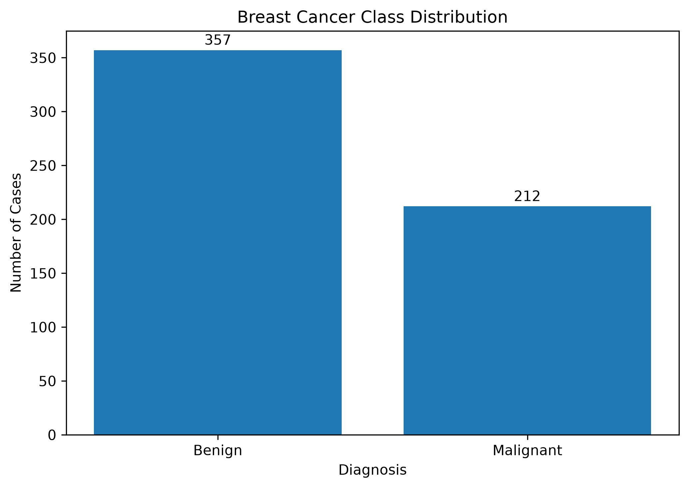
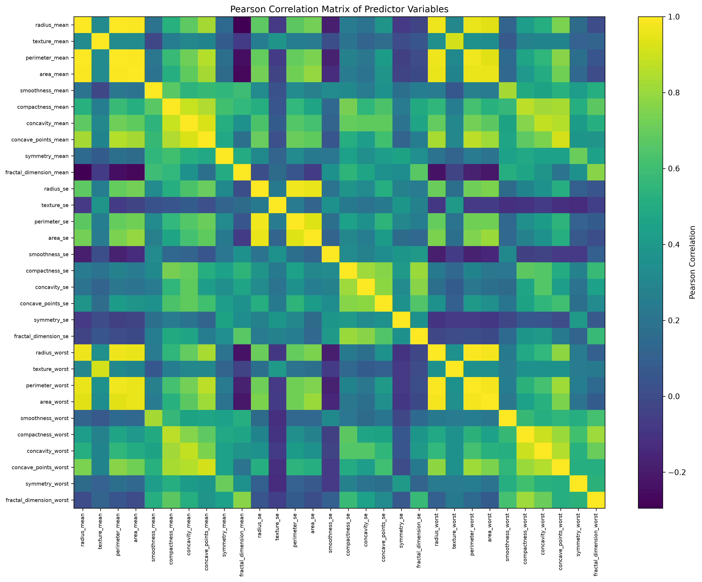
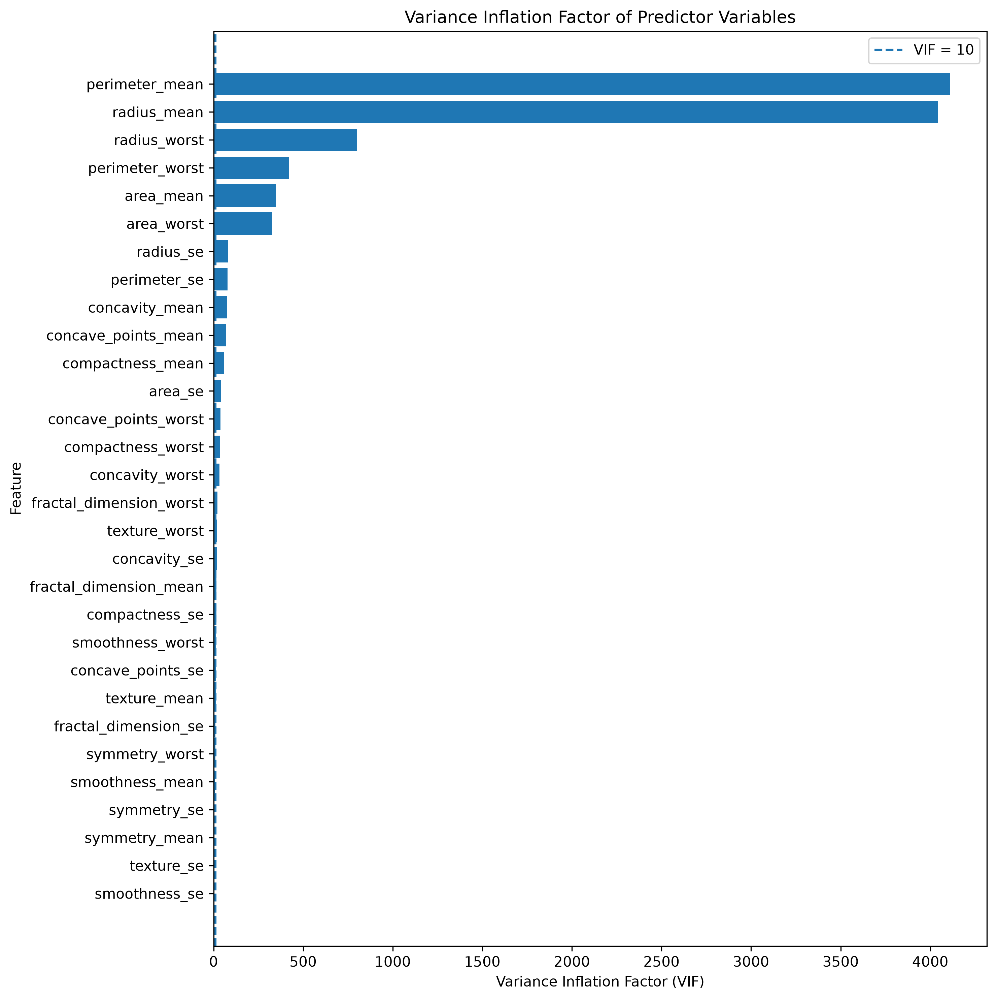
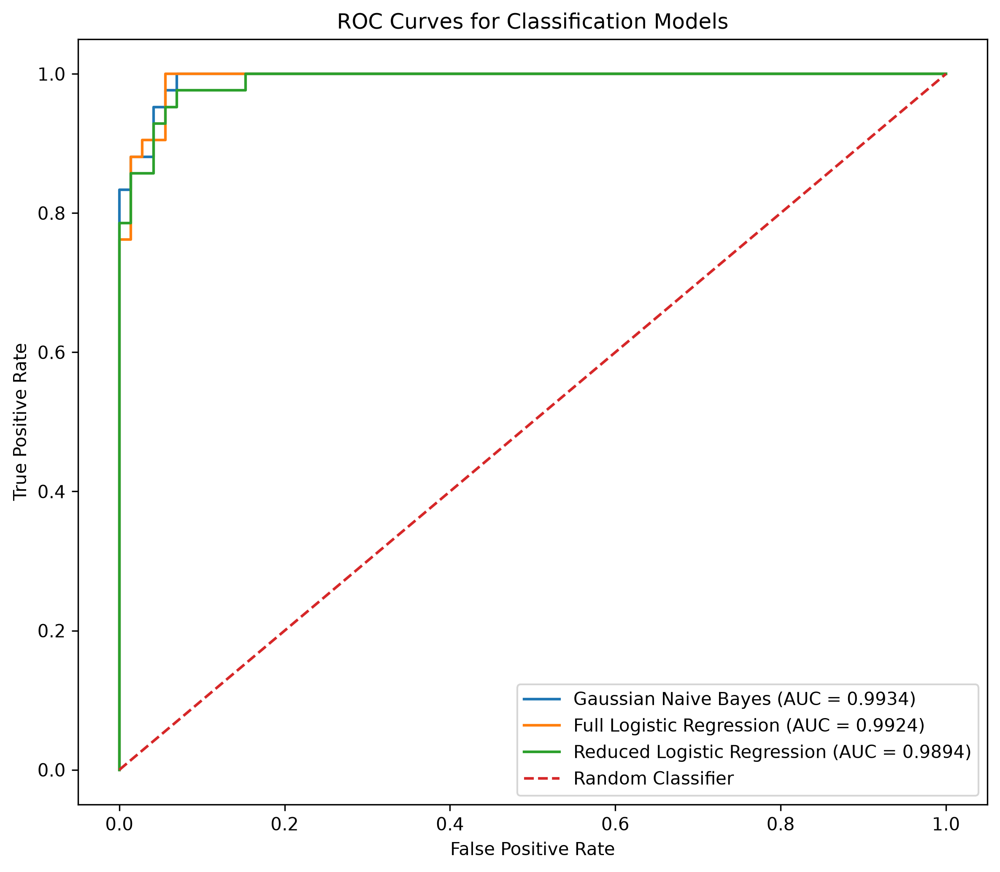
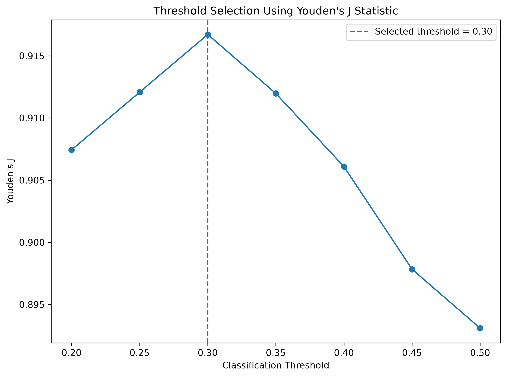
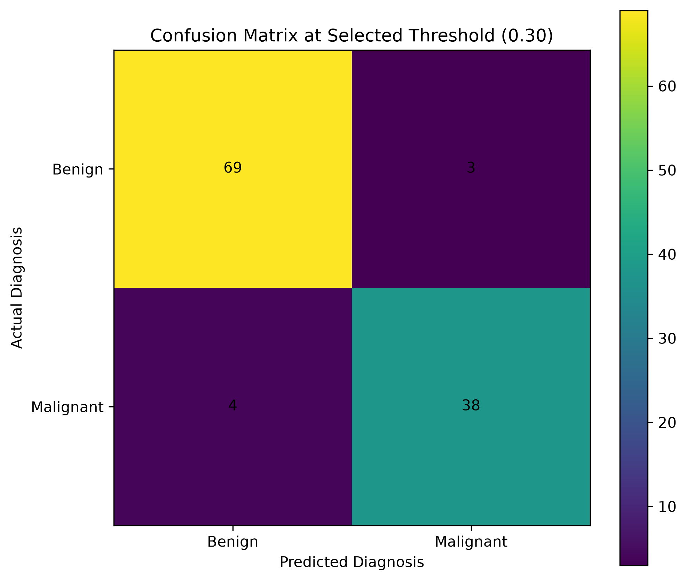

# Probabilistic Breast Cancer Classification

A statistical and probabilistic machine learning study for classifying breast tumors as **benign or malignant** using the Breast Cancer Wisconsin (Diagnostic) dataset.

The project combines **descriptive statistics, hypothesis testing, correlation analysis, multicollinearity analysis, probabilistic modeling, logistic regression, model evaluation, and decision-threshold optimization** to build and evaluate a reproducible breast cancer classification pipeline.

---

## Project Overview

Breast cancer diagnosis involves distinguishing malignant tumors from benign tumors using quantitative characteristics extracted from digitized images of fine-needle aspirate (FNA) samples.

This project investigates whether statistical and probabilistic techniques can be used to:

- Identify features that significantly differ between benign and malignant tumors.
- Examine the distributional properties of the predictors.
- Detect strong correlations and multicollinearity among features.
- Reduce redundant predictors using correlation and VIF analysis.
- Compare probabilistic and discriminative classification models.
- Evaluate models using clinically relevant classification metrics.
- Optimize the classification decision threshold using **Youden's J statistic**.
- Analyze the trade-off between sensitivity and specificity.
- Produce a fully reproducible Python implementation.

---

# Objectives

The main objectives of this project are:

1. Perform exploratory and descriptive statistical analysis of the dataset.
2. Investigate normality assumptions using the **Shapiro-Wilk test**.
3. Determine whether tumor measurements differ significantly between benign and malignant cases using **Welch's two-sample t-test**.
4. Identify highly correlated predictors using **Pearson correlation**.
5. Quantify multicollinearity using the **Variance Inflation Factor (VIF)**.
6. Reduce redundant predictors while retaining statistically informative features.
7. Develop and compare:
   - Gaussian Naive Bayes
   - Logistic Regression
8. Evaluate probabilistic predictions using:
   - Brier Score
   - Log Loss
   - ROC-AUC
9. Optimize the classification threshold using **5-fold stratified cross-validation** and **Youden's J statistic**.
10. Evaluate the final locked threshold on an unseen test set.

---

# Dataset

The project uses the **Breast Cancer Wisconsin (Diagnostic)** dataset.

### Dataset characteristics

| Property | Value |
|---|---:|
| Total observations | 569 |
| Predictor variables | 30 |
| Target variable | Diagnosis |
| Benign cases | 357 |
| Malignant cases | 212 |
| Benign proportion | 62.7% |
| Malignant proportion | 37.3% |

The original diagnosis labels are:

- `B` = Benign
- `M` = Malignant

For modeling, these are encoded as:

```text
B → 0
M → 1
```

The dataset contains measurements derived from digitized images of breast mass cell nuclei.

---

# Methodology

The complete analytical pipeline is:

```text
Dataset
   │
   ▼
Data Preprocessing
   │
   ▼
Train/Test Split
   │
   ▼
Descriptive Statistics
   │
   ▼
Shapiro-Wilk Normality Testing
   │
   ▼
Welch's Two-Sample t-Test
   │
   ▼
Pearson Correlation Analysis
   │
   ▼
Variance Inflation Factor (VIF)
   │
   ▼
Feature Reduction
   │
   ▼
Model Training
   ├───────────────┐
   ▼               ▼
Gaussian NB    Logistic Regression
   │               │
   └───────┬───────┘
           ▼
     Model Evaluation
           │
           ▼
  5-Fold Stratified CV
           │
           ▼
  Youden's J Threshold
           │
           ▼
    Locked Threshold
           │
           ▼
 Final Test Evaluation
```

---

# 1. Data Preprocessing

The dataset is loaded from `data/wdbc.data`.

The preprocessing pipeline:

1. Assigns meaningful feature names.
2. Converts diagnosis labels into binary values.
3. Removes the dataset identifier.
4. Separates predictors and target.
5. Performs an **80/20 stratified train-test split**.

The split uses:

```python
random_state = 42
```

### Dataset split

| Set | Samples |
|---|---:|
| Training | 455 |
| Testing | 114 |

Stratification preserves the benign/malignant class proportions between the training and testing sets.

---

# 2. Descriptive Analysis

The class distribution is first examined to understand the composition of the dataset.



The dataset contains more benign observations than malignant observations, with malignant cases representing approximately 37.3% of the dataset.

---

# 3. Normality Analysis

The **Shapiro-Wilk test** was applied to feature distributions within the benign and malignant training subsets.

The hypotheses are:

- **H₀:** The observations are drawn from a normally distributed population.
- **H₁:** The observations are not drawn from a normally distributed population.

Using:

```text
α = 0.05
```

Most feature-class combinations reject the strict normality assumption.

This is particularly relevant when interpreting the Gaussian Naive Bayes model, since Gaussian Naive Bayes assumes that each feature follows a Gaussian distribution conditional on the class.

Rather than treating this assumption as automatically valid, the model is evaluated empirically using independent test-set performance.

---

# 4. Welch's Two-Sample t-Test

Welch's independent two-sample t-test was used to investigate whether individual features have significantly different means between benign and malignant tumors.

The hypotheses are:

```text
H₀: μB = μM
H₁: μB ≠ μM
```

Welch's test was selected because it does not require the two groups to have equal variances.

At:

```text
α = 0.05
```

**26 out of 30 features were statistically significant.**

The four features that were not statistically significant were:

| Feature | p-value |
|---|---:|
| `fractal_dimension_mean` | 0.7667 |
| `texture_se` | 0.8354 |
| `smoothness_se` | 0.1053 |
| `symmetry_se` | 0.8871 |

This analysis provides statistical evidence that many of the measured tumor characteristics differ substantially between benign and malignant cases.

---

# 5. Pearson Correlation Analysis

Pearson correlation was used to identify linear relationships between predictors.

A threshold of:

```text
|r| > 0.95
```

was used to identify extremely strong correlations.

The analysis identified **15 highly correlated feature pairs**.

For example:

| Feature Pair | Approx. Correlation |
|---|---:|
| `radius_mean` – `perimeter_mean` | 0.9978 |
| `radius_worst` – `perimeter_worst` | 0.9937 |
| `radius_mean` – `area_mean` | 0.9867 |
| `perimeter_mean` – `area_mean` | 0.9860 |
| `radius_worst` – `area_worst` | 0.9831 |
| `radius_se` – `area_se` | 0.9516 |

These relationships indicate substantial redundancy among several geometric measurements.



---

# 6. Multicollinearity Analysis using VIF

The **Variance Inflation Factor (VIF)** was calculated to quantify multicollinearity.

VIF is defined as:

\[
VIF_j = \frac{1}{1-R_j^2}
\]

where \(R_j^2\) is obtained by regressing predictor \(j\) against the remaining predictors.

Several variables exhibited extremely high VIF values.

Examples include:

| Feature | VIF |
|---|---:|
| `perimeter_mean` | 4110.57 |
| `radius_mean` | 4041.75 |
| `radius_worst` | 799.62 |
| `perimeter_worst` | 419.64 |
| `area_mean` | 348.19 |
| `area_worst` | 326.08 |



These values demonstrate substantial multicollinearity among the original predictors.

---

# 7. Feature Reduction

To reduce redundant information, seven highly redundant predictors were removed:

```text
perimeter_mean
area_mean
perimeter_se
area_se
radius_worst
perimeter_worst
area_worst
```

This reduced the feature space from:

```text
30 features → 23 features
```

The reduced feature set was subsequently evaluated using Logistic Regression.

Importantly, feature reduction was performed as an analytical experiment rather than assuming that fewer features automatically produce better predictive performance.

---

# 8. Machine Learning Models

Two primary classification approaches were investigated.

## Gaussian Naive Bayes

Gaussian Naive Bayes models the conditional probability of each feature using a Gaussian distribution:

\[
P(x_j|C_k)
=
\frac{1}{\sqrt{2\pi\sigma_{kj}^2}}
e^{-\frac{(x_j-\mu_{kj})^2}{2\sigma_{kj}^2}}
\]

Bayes' theorem is then used to estimate the posterior probability of each class.

The model provides a direct probabilistic interpretation of classification.

---

## Logistic Regression

Logistic Regression models the probability of malignancy using:

\[
P(Y=1|X)
=
\frac{1}{1+e^{-z}}
\]

where:

\[
z = \beta_0+\beta_1X_1+\cdots+\beta_pX_p
\]

The coefficients can also be interpreted through odds ratios:

\[
OR=e^\beta
\]

Logistic Regression was evaluated using both:

- The complete 30-feature dataset.
- The reduced 23-feature dataset.

---

# 9. Model Comparison

The models were evaluated on the held-out test set using accuracy, sensitivity, specificity, precision, F1-score, Brier score, ROC-AUC, and log loss.

| Model | Accuracy | Sensitivity | Specificity | Precision | F1 | Brier | ROC-AUC | Log Loss |
|---|---:|---:|---:|---:|---:|---:|---:|---:|
| Gaussian NB | 93.86% | 83.33% | 100.00% | 100.00% | 90.91% | 0.0590 | 0.9934 | 0.4086 |
| Logistic Regression | 93.86% | 85.71% | 98.61% | 97.30% | 91.14% | 0.0419 | 0.9924 | 0.1214 |
| Reduced Logistic Regression | 92.11% | 85.71% | 95.83% | 92.31% | 88.89% | 0.0479 | 0.9894 | 0.1526 |

The full Logistic Regression model achieved the lowest Brier score and Log Loss among the evaluated models, indicating strong probabilistic prediction performance.

The reduced model retained strong predictive performance but showed a small decrease relative to the full model.

---

# 10. ROC Analysis

ROC curves were used to evaluate discrimination across different classification thresholds.



The models achieved ROC-AUC values close to 1, indicating strong separation between benign and malignant observations.

The full Gaussian Naive Bayes model achieved:

```text
ROC-AUC = 0.9934
```

while the full Logistic Regression model achieved:

```text
ROC-AUC = 0.9924
```

---

# 11. Decision Threshold Optimization

A default binary classifier commonly uses:

```text
threshold = 0.50
```

However, the choice of threshold affects the balance between sensitivity and specificity.

Because the objective is binary tumor classification, the threshold was optimized rather than accepting 0.50 automatically.

A **5-fold stratified cross-validation procedure** was performed on the training set.

The candidate thresholds were:

```text
0.20
0.25
0.30
0.35
0.40
0.45
0.50
```

For each threshold, Youden's J statistic was calculated:

\[
J = Sensitivity + Specificity - 1
\]

### Cross-validation results

| Threshold | Accuracy | Sensitivity | Specificity | Youden's J |
|---:|---:|---:|---:|---:|
| 0.20 | 94.95% | 97.06% | 93.68% | 0.9074 |
| 0.25 | 95.38% | 96.47% | 94.74% | 0.9121 |
| **0.30** | **95.82%** | **95.88%** | **95.79%** | **0.9167** |
| 0.35 | 95.82% | 94.71% | 96.49% | 0.9120 |
| 0.40 | 95.60% | 94.12% | 96.49% | 0.9061 |
| 0.45 | 95.38% | 92.94% | 96.84% | 0.8978 |
| 0.50 | 95.38% | 91.76% | 97.54% | 0.8931 |

The maximum Youden's J was obtained at:

```text
Optimal threshold = 0.30
```



The threshold of 0.30 was therefore locked before evaluating the final test-set performance.

---

# 12. Final Test-Set Evaluation

After selecting the threshold using only the training data through cross-validation, the locked threshold of **0.30** was applied to the unseen test set.

### Confusion Matrix

```text
                 Predicted
                 Benign  Malignant
Actual Benign      69       3
Actual Malignant    4      38
```



### Final performance

| Metric | Value |
|---|---:|
| Accuracy | **93.86%** |
| Sensitivity | **90.48%** |
| Specificity | **95.83%** |
| Precision | **92.68%** |
| NPV | **94.52%** |
| F1-score | **91.57%** |
| Brier Score | **0.0419** |
| Log Loss | **0.1214** |
| ROC-AUC | **0.9924** |

The final test-set confusion matrix contains:

```text
TN = 69
FP = 3
FN = 4
TP = 38
```

The optimized threshold improves sensitivity compared with the default 0.50 threshold while retaining high specificity.

---

# Statistical Concepts Demonstrated

This project demonstrates the practical application of several Probability and Statistics concepts:

### Descriptive Statistics
Used to understand dataset composition and feature behavior.

### Probability Distributions
Gaussian distributions are used within Gaussian Naive Bayes.

### Bayes' Theorem
Used to obtain posterior class probabilities from conditional feature probabilities.

### Hypothesis Testing
Welch's two-sample t-test is used to test whether feature means differ between classes.

### Normality Testing
Shapiro-Wilk testing investigates the normality assumption of feature distributions.

### Correlation
Pearson correlation identifies strongly related predictors.

### Multicollinearity
Variance Inflation Factor(VIF) quantifies redundancy among predictors.

### Maximum Likelihood Estimation
Logistic Regression parameters are estimated through likelihood-based optimization.

### Conditional Probability
Classification models estimate:

\[
P(Y|X)
\]

to determine the probability of malignancy.

### Sensitivity and Specificity
Used to quantify classification performance for the two diagnostic classes.

### ROC-AUC
Measures discrimination across classification thresholds.

### Brier Score
Evaluates the accuracy of probabilistic predictions.

### Log Loss
Penalizes incorrect and overconfident probability predictions.

### Youden's J Statistic
Used to select a classification threshold balancing sensitivity and specificity.

---

# Project Structure

```text
breast-cancer-classification/
│
├── data/
│   └── wdbc.data
│
├── figures/
│   ├── class_distribution.png
│   ├── correlation_heatmap.png
│   ├── vif_plot.png
│   ├── roc_curves.png
│   ├── confusion_matrix.png
│   └── threshold_youden.png
│
├── notebook/
│   └── Breast_Cancer_Classification.ipynb
│
├── results/
│   ├── model_results.txt
│   └── statistical_analysis.txt
│
├── src/
│   ├── data_preprocessing.py
│   ├── statistical_analysis.py
│   ├── models.py
│   ├── evaluation.py
│   ├── threshold_selection.py
│   ├── final_evaluation.py
│   └── visualization.py
│
├── test_preprocessing.py
├── requirements.txt
├── .gitignore
└── README.md
```

---

# Installation

Clone the repository:

```bash
git clone https://github.com/Sohan-2025/breast-cancer-classification.git
cd breast-cancer-classification
```

Create a virtual environment:

```bash
python -m venv venv
```

Activate it on Windows:

```powershell
venv\Scripts\activate
```

Install the dependencies:

```bash
pip install -r requirements.txt
```

---

# Running the Project

The individual analysis stages can be executed from the project root.

### Statistical analysis

```bash
python src/statistical_analysis.py
```

### Model training

```bash
python src/models.py
```

### Model evaluation

```bash
python src/evaluation.py
```

### Threshold optimization

```bash
python src/threshold_selection.py
```

### Final evaluation

```bash
python src/final_evaluation.py
```

### Generate visualizations

```bash
python src/visualization.py
```

---

# Reproducibility

The project is designed so that the major analytical steps can be reproduced from the source code.

Key reproducibility settings include:

```text
Train/test split = 80/20
random_state = 42
Stratified splitting
5-fold Stratified Cross-Validation
Significance level α = 0.05
Correlation threshold |r| > 0.95
Final threshold = 0.30
```

The raw dataset, source code, generated statistical results, and figures are included in the repository.

---

# Limitations

Several limitations should be considered when interpreting the results:

1. The dataset contains 569 observations and therefore represents a relatively small dataset for modern machine learning standards.
2. The predictors are derived from digitized FNA images and may not represent all clinical variables used in real-world diagnosis.
3. The Gaussian assumption investigated through normality testing was not uniformly supported across all feature-class combinations.
4. Strong multicollinearity exists among several geometric measurements.
5. Model performance on this dataset should not be interpreted as evidence of clinical readiness.
6. External validation on an independent dataset would be required before considering real-world deployment.

---

# Future Work

Potential extensions include:

- External validation using an independent breast cancer dataset.
- Calibration analysis and calibration curves.
- Bootstrap confidence intervals for model metrics.
- More systematic feature-selection techniques.
- Comparison with Support Vector Machines, Random Forests, and gradient boosting methods.
- Investigation of regularization effects in Logistic Regression.
- Probability calibration techniques.
- Cost-sensitive threshold optimization.
- Statistical comparison of model performance across repeated resampling experiments.
- Development of an interpretable clinical decision-support prototype.

---

# Key Findings

The major findings of the study are:

- **26 of 30 features** showed statistically significant differences between benign and malignant groups using Welch's t-test.
- **15 highly correlated feature pairs** were identified using the `|r| > 0.95` criterion.
- VIF analysis revealed severe multicollinearity among several geometric measurements.
- Feature reduction decreased the predictor space from **30 to 23 variables**.
- Both Gaussian Naive Bayes and Logistic Regression achieved strong discrimination.
- Full Logistic Regression achieved a **ROC-AUC of 0.9924**.
- Five-fold cross-validation identified **0.30** as the optimal decision threshold according to Youden's J statistic.
- The final locked threshold achieved **90.48% sensitivity** and **95.83% specificity** on the unseen test set.
- The final model achieved a **Brier Score of 0.0419** and **Log Loss of 0.1214**, indicating strong probabilistic prediction performance.

---

# Technologies Used

- Python
- Pandas
- NumPy
- SciPy
- Scikit-learn
- Statsmodels
- Matplotlib
- Jupyter Notebook
- Git & GitHub

---

# Project Status

**Completed**

The current repository contains the complete preprocessing, statistical analysis, model training, evaluation, threshold optimization, final evaluation, visualization, and reproducibility pipeline.

---

## Dataset Reference

The project uses the Breast Cancer Wisconsin (Diagnostic) dataset originally provided through the UCI Machine Learning Repository.

The dataset is included in this repository as:

```text
data/wdbc.data
```

---

> **Note:** This project is intended for academic and statistical analysis purposes. The reported model should not be interpreted as a clinically validated diagnostic system.
